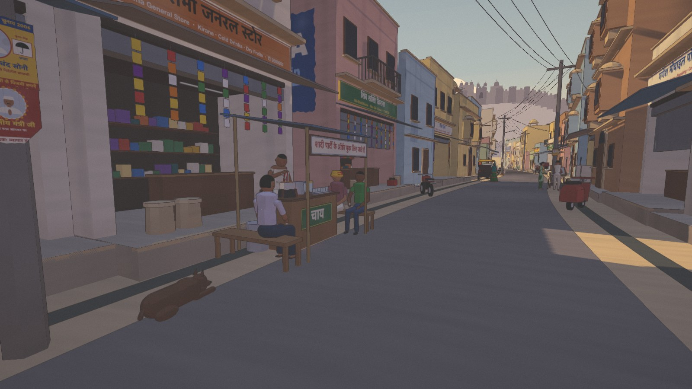
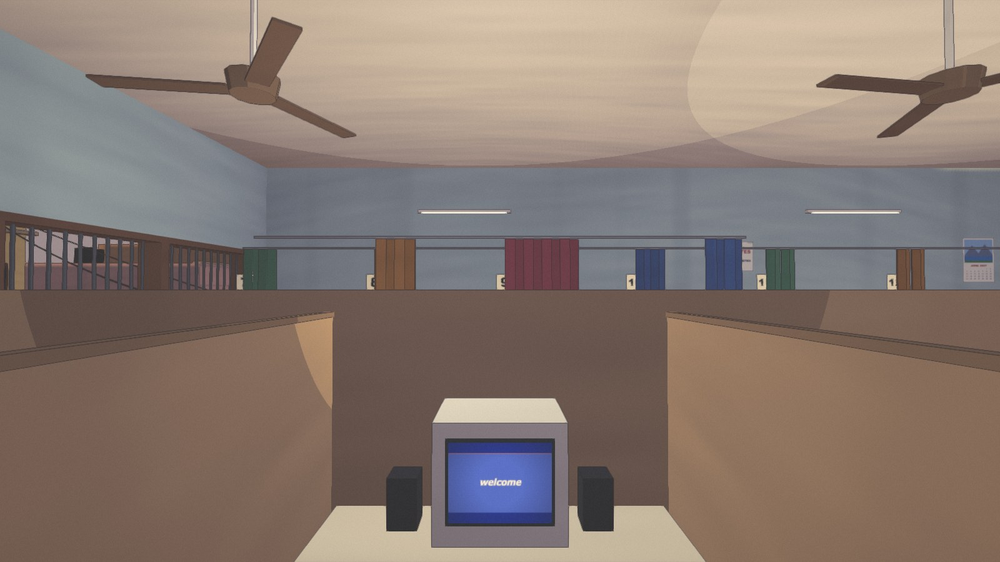
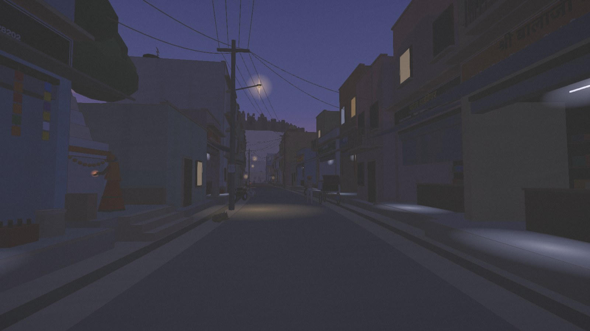

# Saturday, 5 Baje

A short first-person walk into the cyber cafes of the 2000s.

**▶ Play it in your browser: [saturday5baje.com](https://saturday5baje.com)**
(free, no download; on a laptop, or a phone held sideways; Chrome or Safari;
sound on). Also on [itch.io](https://aayushgarg2903gmailcom.itch.io/saturday-5-baje).



It's a Saturday afternoon in June 2007, in a small Rajasthan town. Mummy
stops you at the door: "Cafe ja raha hai? Ek ghante se zyada mat baithna,
haan!", and hands you a chit of errands.

You walk through the town: the chai tapri, the kachori and jalebi stalls, a
temple bell, cows in the road, kids playing gully cricket in the gali, the
sabzi mandi, the bus stand, the railway crossing. You climb the steep stairs
to the cyber cafe and sit down in booth 2. The modem dials.

Your best friend moved to Pune this summer, and you promised: every Saturday,
5 pm, on Yaaho! Messenger. The girl from tuition is online too, till 6.

Chat with both, download a song on dial-up, mail a photo from your pen drive,
scroll through Yorkut, watch a video buffer forever, and keep looking up at
the clock. Then log off, pay the owner, and walk home as the tubelights
flicker on. Mummy is waiting at the door, and she will ask about the chit.

On the way there's more, if you want it: pani puri (meetha, medium or
teekha), a haircut at the saloon, an over of gully cricket, the 6:30 bus from
Jaipur, and the trains.




## Controls

| | |
|---|---|
| Click | start (captures the mouse) |
| W A S D | walk |
| Mouse | look |
| Shift | walk faster |
| Tab | Mummy's chit |
| E | talk, buy, sit down / get up, pay, go home |
| Click (seated) | lean in to use the computer |
| Esc | lean back from the computer |
| T | look up at the wall clock |
| M | mute |

On a phone: hold it sideways, left thumb to walk (pull further to walk
faster), right thumb to look around.

About 20–30 minutes.

## How it's made

- **Three.js + TypeScript**, built with Vite. `three` is the only runtime
  dependency.
- **Almost everything is made in code**: buildings and people from simple
  shapes, every signboard, poster and photo painted on a canvas, and most
  sounds synthesized with the Web Audio API (the ceiling fans, the temple
  bell, the conch, and the film tune on the chai tapri's radio). A handful of
  real sounds were recorded on a phone: the modem, the train's wheels, a
  shutter, a cycle bell and a pressure cooker. The whole game is about a
  1.3 MB download.
- **A painted, cel-shaded look**: toon shading with violet-tinted shadows, ink
  outlines and a warm colour grade (`src/render/`).
- **The computer is a web page inside the game**: a Windows XP look-alike
  desktop with its own messenger, browser and sites (`src/desktop/`). The
  story on it is plain data you can edit: `src/desktop/story.ts`.
- **The light follows the clock**, from the 4:30 pm sun to blue dusk
  (`src/render/daylight.ts`), and the street's lamps come on one by one
  (`src/world/evening.ts`).

Every name, site, brand and song in it is a look-alike (Yorkut, Yaaho!,
MeToob, Windoze XP…), and the tune is original.

## Run it yourself

You need [Node.js](https://nodejs.org) 20.19+ or 22.12+.

```bash
npm install      # once
npm run dev      # the game with dev tools: http://127.0.0.1:5180
npm run build    # the finished game, into dist/
npm run preview  # play the finished build: http://127.0.0.1:5181
npm run reel     # turn recorded clips into videos (see src/dev/recorder.ts)
```

## Where things are

- `BRIEF.md`: what the game is (the story, the look, the rules)
- `TASKS.md`: how it was built, phase by phase
- `CLAUDE.md`: how the code is organised, and the bugs that have already bitten
- `src/`: `world/` (the street and the cafe), `people/`, `audio/`,
  `desktop/` (the computer), `render/` (the look), `core/` (player, clock,
  input)
